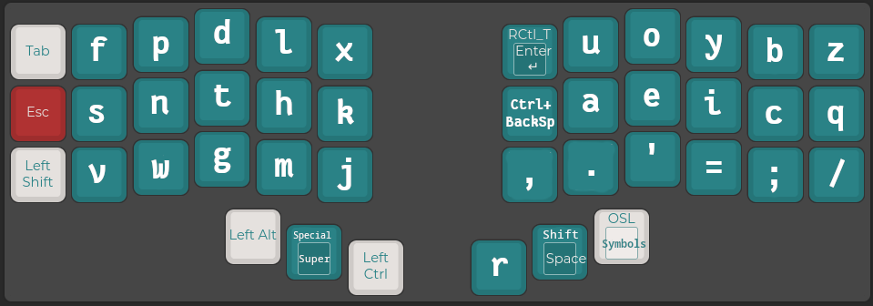
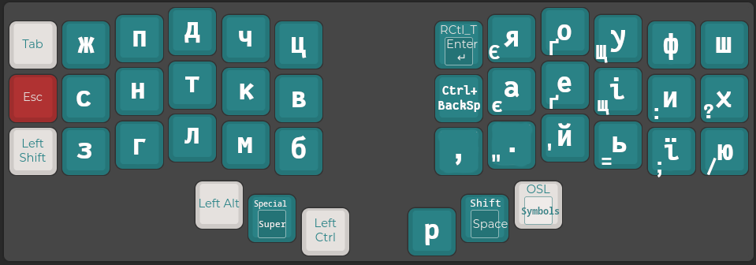
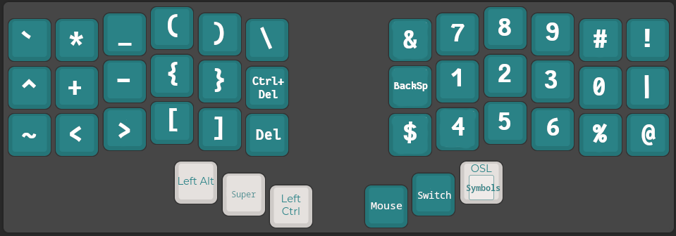
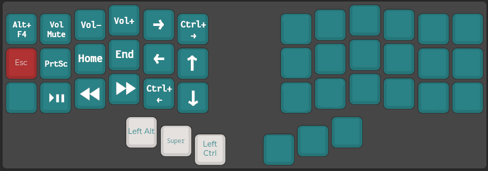
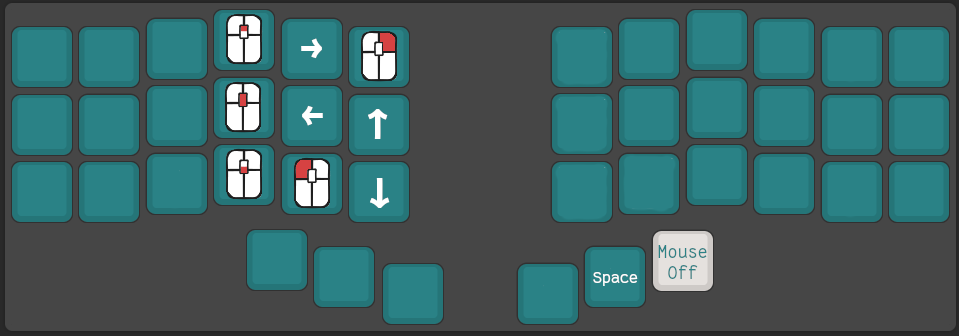
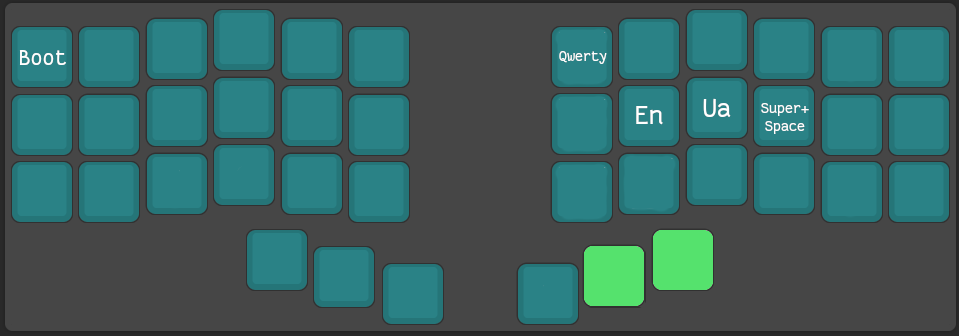

# Facet layout

A QMK keyboard layout for beekeeb/piantor_pro:
- The English layout based on Hands Down Promethium
- The Ukrainian layout generated based on a custom corpus, with home row and vowels placed to be similar to Hands Down Promethium English layout

Special treatment for symbols:
- Special layer uses hjhl for the left-down-up-right movement
- Numbers located similarly to a numpad, but with most used ones on home row
- Ctrl+BackSpace to delete the whole word by defauld
- A Mouse layout - use keyboard to send mouse actions

Better language switching:
- If Ctrl+Alt+1 and +2 are mapped to EN and UA layouts in the OS:
  - Switching layouts will also change language
  - Using symbol layer will produce the same symbols both in UA and EN layouts

*Note*: as a bare Super (or Meta/Cmd/Win) key is used rarely, the key for it by default changes the layer to Symbols, when held. To press Super symbol once, double tap its key. To use Super+Key combination, hold the Special and Left Ctrl keys simultaneously.

# English layout

# Ukrainian layout

The secondary keys are available through the special layer

## Building

1. Install the environment from the [QMK setup guide](https://docs.qmk.fm/newbs_getting_started)
2. Place `keymap.c`, `config.h`, and `rules.mk` in `keyboards/beekeeb/piantor_pro/keymaps/facet_layout/` inside your QMK firmware checkout
3. Run `qmk doctor`
4. Run `qmk compile -kb beekeeb/piantor_pro -km facet_layout`

The build produces `beekeeb_piantor_pro_facet_layout.uf2`
Building does not flash the keyboard

### Flashing both halves

Both halves use the same UF2 file
The board reads its left/right identity from a hardware pin, not an EEPROM setting
Update both halves together to avoid different QMK split-transport versions

1. Disconnect USB power before disconnecting the inter-half cable
2. Hold one half's BOOT button while connecting that half directly to the computer by USB
3. Release BOOT when the `RPI-RP2` volume appears
4. Copy `beekeeb_piantor_pro_facet_layout.uf2` to that volume
5. Wait for the volume to disappear and the keyboard to reconnect
6. Disconnect USB and repeat steps 2-5 for the other half with the same file
7. Disconnect USB power before reconnecting the inter-half cable
8. Reconnect the keyboard's normal USB cable

With matching firmware running, `QK_BOOT` can enter the bootloader without holding BOOT or reconnecting USB
Hold the right outer Symbols thumb key, then the right middle thumb key to reach Switch
Press the top-left key
This resets only the USB-connected controller
Use the physical BOOT procedure if that key is unavailable or the running mapping differs

## macOS input sources

Use ABC for English and Ukrainian-PC (`com.apple.keylayout.Ukrainian-PC`) for Ukrainian
Configure Ctrl+Alt+1 to select ABC and Ctrl+Alt+2 to select Ukrainian-PC
Karabiner-Elements can provide these absolute input-source shortcuts
Set its virtual keyboard type to ANSI for the Piantor's ANSI configuration

The Ukrainian Special layer sends different punctuation keys on macOS:

| Character | Linux key | macOS Ukrainian-PC key |
| --- | --- | --- |
| ґ | Backslash | Grave |
| Ґ | Shift+Backslash | Shift+Grave |
| ʼ | Grave | Backslash |
| / | Right Alt+Slash | Keypad Divide |

These mappings come from macOS's Ukrainian-PC layout translation with ANSI keyboard type 40
They apply only to the dedicated punctuation keys on Ukrainian Special
The Symbols layer retains its ABC keycodes
OS detection selects the host-specific mappings
`OS_TOGG` on the Switch layer manually toggles macOS handling if detection selects the wrong host

Only entering or leaving Symbols while Ukrainian is the default layer sends an input-source shortcut
Each shortcut waits 40 ms for the host, without an acknowledgment from macOS
Entering or leaving Ukrainian Special sends no input-source shortcut and adds no wait

Physical checks confirmed ґ, ʼ, and / with this firmware on the USB-connected controller
Uppercase Ґ is not yet confirmed. The second controller still runs older firmware by choice

The roughly two-second typing block also occurs after manually selecting Ukrainian-PC from ABC in the macOS menu bar
This reproduction needs neither the firmware shortcut nor a Symbols transition
The host-specific cause remains unresolved. No firmware timing change was made

# Symbols layer

# Special layer

# Mouse layer

Do mouse actions using your keyboard

# Switch layer

Switch layouts between Ukrainian, English and regular Qwerty

